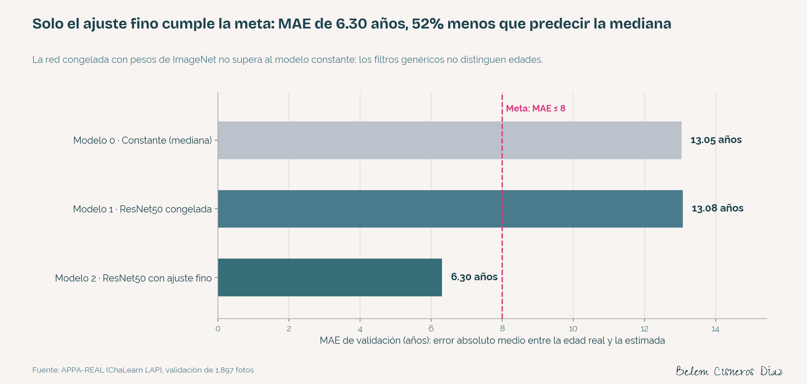
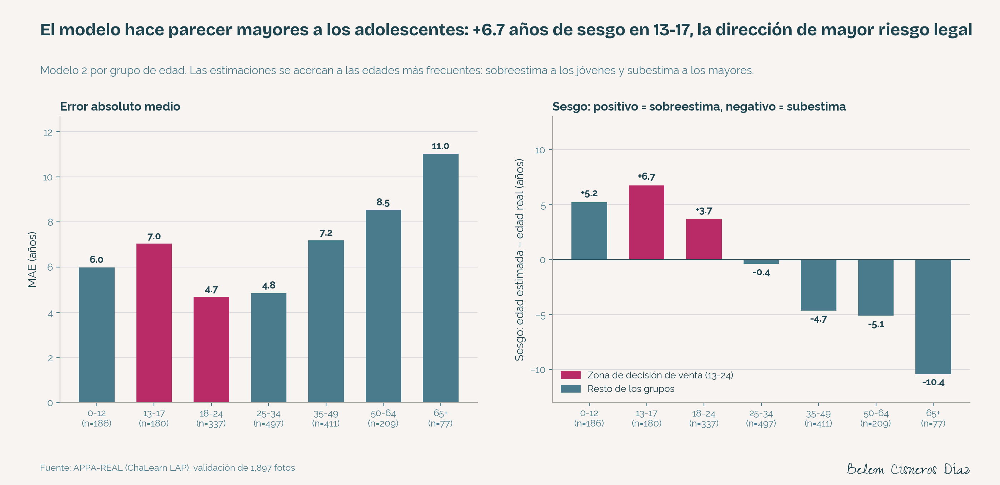
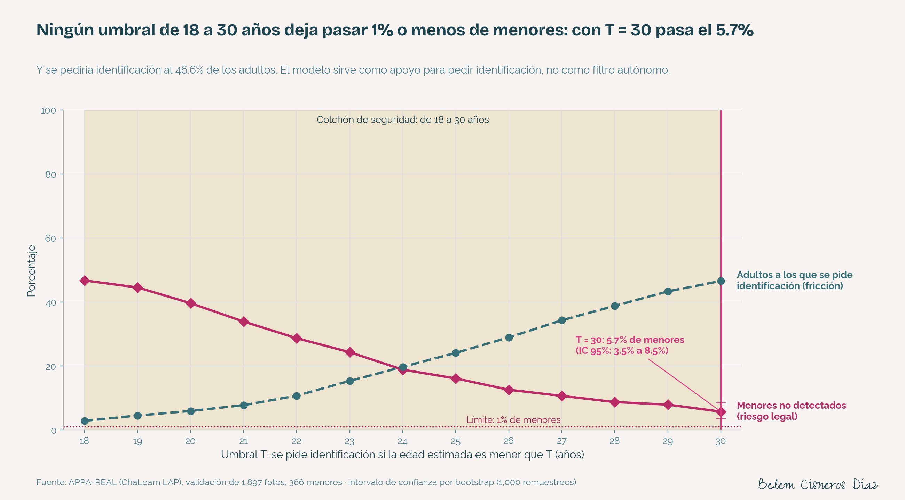

# Good Seed — Verificación automática de edad en cajas

     

Modelo de visión artificial que estima la edad de una persona a partir de la foto de su rostro, para apoyar a una cadena de supermercados a no vender alcohol a menores de edad.

📊 **Case study:** [he1109-ci3l0.github.io/good-seed-verificacion-edad](https://he1109-ci3l0.github.io/good-seed-verificacion-edad/)

## Pregunta de negocio

¿Puede una foto del rostro, tomada por la cámara de la caja, estimar la edad con un error medio de 8 años o menos, y cómo debe usarse esa estimación para que la cadena no venda alcohol a menores sin frenar la operación?

## Resultado

El modelo final (ResNet50 con ajuste fino) **cumple la meta (MAE ≤ 8)** con un **error absoluto medio de 6.30 años** en validación (IC 95%: 6.05 a 6.55), 52% menos que predecir siempre la mediana. Por su sesgo en adolescentes, se recomienda como **apoyo para pedir identificación**, no como filtro autónomo.

### Comparación de modelos

| # | Modelo | MAE de validación | Desviación de las estimaciones | ¿Cumple MAE ≤ 8? |
|---|---|---|---|---|
| 0 | Constante (mediana de entrenamiento) | 13.05 | 0.00 | No |
| 1 | ResNet50 congelada + cabeza entrenable | 13.08 | 1.06 | No |
| 2 | **ResNet50 con ajuste fino** | **6.30** | 14.45 | **Sí** |



## Lo que gana la empresa

**El costo de no cumplir es alto.** En la Ciudad de México, permitir el acceso o la venta de alcohol a menores se sanciona con multas de 300 a 700 Unidades de Cuenta (33,942 a 79,198 pesos con el valor 2025 de 113.14) y la clausura del establecimiento ([Expansión, 2024](https://politica.expansion.mx/voces/2024/06/28/columnainvitada-diversion-segura-y-responsabilidad-empresarial)); en caso de clausura, el artículo 69 añade de 1,000 a 3,000 Unidades de Cuenta, es decir, **113,140 a 339,420 pesos** ([Posta, 2025](https://www.posta.com.mx/cdmx/operativo-nocturno-deja-38-chelerias-fuera-de-servicio-conoce-cuanto-debes-pagar-si-cierran-tu-local/vl2050638)). En 2025 se habían clausurado 565 establecimientos en operativos que atienden denuncias que incluyen la venta de alcohol a menores ([Expansión, 2025](https://politica.expansion.mx/cdmx/2025/05/09/locales-suspendidos-cdmx-operativos-venta-ilegal-alcohol)).

**La tecnología ya genera ahorros en la industria.** Las verificaciones de edad son más del 50% de las intervenciones del personal en cajas de autoservicio ([Yoti con NCR, 2018](https://www.yoti.com/blog/streamlining-the-self-checkout-experience-with-ncr/)). Con estimación facial, Diebold Nixdorf redujo la verificación de hasta 2 minutos a menos de 10 segundos y la intervención humana en 75% ([caso de estudio, 2025](https://yoti.com/wp-content/uploads/2025/02/Diebold_Nixdorf_Case-Study_040225_V2.pdf)); en la prueba regulatoria del Ministerio del Interior británico, la tecnología resolvió hasta el 40% de las verificaciones y el 70% de los clientes dijo que la usaría ([techUK, 2023](https://www.techuk.org/insights/guest-insights/how-digital-age-verification-can-transform-the-self-checkout-techukdigitaltrade)).

**La inversión es acotada:** las cámaras ya existen; el costo es el desarrollo, el cómputo y la integración con la caja.

| Escenario por tienda (supuestos ilustrativos: 150 ventas de alcohol al día, 1 minuto por verificación, 365 días) | Uso del modelo | Horas de personal liberadas al año | Retorno principal |
|---|---|---|---|
| **A · Prototipo actual** (MAE 6.30) | Activa la solicitud de identificación; la decisión es humana | 0 | Control consistente y registrado: **una sola clausura evitada supera los 113,000 pesos** |
| **B · Precisión comercial** (MAE ~1 en adolescentes, [Yoti, 2025](https://www.yoti.com/blog/yoti-facial-age-estimation-reaches-new-accuracy-for-teenagers-ready-for-online-safety-act-enforcement/)) | Resuelve hasta el 40% de las verificaciones | ~365 | Tiempo de personal y filas más cortas, además del cumplimiento |

*Good Seed es un cliente ficticio: el escenario por tienda usa supuestos explícitos, no cifras reales.*

**Umbral recomendado y su compensación.** El modelo pide identificación si la edad estimada es menor que un umbral T. La regla buscaba el T más bajo, entre 18 y 30 años, con ≤ 1% de menores no detectados; **ningún umbral la cumple**. Con T = 30, pasaría el 5.7% de los menores (21 de 366) y se pediría identificación al 46.6% de los adultos. Por eso la ruta recomendada es un piloto del escenario A mientras el modelo se mejora hasta un error compatible con el colchón de 3 años que exige el regulador alemán KJM ([Yoti, 2025](https://www.yoti.com/blog/age-estimation-approved-kjm-highest-age-assurance-level-18-adult-content/)).

## Hallazgos

1. **El ajuste fino es indispensable.** La red congelada con pesos de ImageNet (MAE 13.08) no supera al modelo constante: sus estimaciones casi no varían (desviación de 1.06 años). ImageNet no es un conjunto de rostros.
2. **El modelo final cumple la meta con holgura:** MAE de 6.30 años (IC 95%: 6.05 a 6.55), con parada temprana en la época 17 y mejores pesos de la época 14.
3. **Acerca sus estimaciones a las edades más frecuentes:** sobreestima a los jóvenes y subestima a los mayores (sesgo de -10.4 años en 65+).
4. **El riesgo está en los adolescentes:** en 13-17, MAE de 7.05 y sesgo de **+6.74 años**, la dirección de mayor riesgo legal.
5. **Ningún umbral de 18 a 30 años deja pasar ≤ 1% de menores;** con T = 30 pasa el 5.7% (IC 95%: 3.5% a 8.5%).
6. **El archivo de etiquetas no está en orden aleatorio:** el primer 25% es 2.1 años más joven que el resto, así que las filas se mezclan antes de dividir.
7. **Las edades redondas (25 y 30) están sobrerrepresentadas,** un patrón compatible con edades declaradas.

| | |
|---|---|
|  |  |

## Cómo está hecho

1. **Datos:** APPA-REAL, 7,591 fotografías con edad real; ninguna se publica.
2. **Mezcla y división:** filas mezcladas con `RANDOM_STATE = 12345`; 75% entrenamiento (5,694) y 25% validación (1,897, con 366 menores).
3. **Preprocesamiento:** 224 × 224 píxeles, `rescale=1/255` y reflejo horizontal solo en entrenamiento.
4. **Modelos:** constante (mediana), ResNet50 congelada y ResNet50 con ajuste fino, con cabeza `GlobalAveragePooling2D` + `Dense(1, relu)`.
5. **Entrenamiento:** pérdida MSE, métrica MAE, Adam (0.001 congelada; 0.0001 ajuste fino), parada temprana con paciencia 3 sobre `val_mae`; en CPU local (Apple M5, 16 GB).
6. **Evaluación:** MAE global y por grupo, sesgo, curva de umbral de 18 a 30 años e intervalos de confianza del 95% por *bootstrap* (1,000 remuestreos).

### Estructura

```
good-seed-verificacion-edad/
├── notebooks/
│   ├── good_seed_verificacion_edad.ipynb   análisis completo
│   └── referencia_tripleten.ipynb          plantilla de TripleTen completada, sin fotos
├── src/
│   ├── datos.py          lectura, mezcla y generadores (load_train, load_test)
│   ├── modelo.py         modelos 0, 1 y 2, y train_model
│   ├── evaluacion.py     MAE, error por grupo, umbral, intervalos y metricas.json
│   ├── figuras.py        las seis figuras de figures/
│   └── predict.py        edad estimada de una foto nueva y decisión de umbral
├── script/
│   ├── entrenar.py            entrena los modelos 0, 1 y 2 desde la terminal
│   └── run_model_on_gpu.py    script generado por la plantilla de TripleTen
├── resultados/            registros por época, salidas de entrenamiento y metricas.json
├── figures/               figuras exportadas (sin fotos de rostros)
├── assets/fuentes/        tipografías del proyecto con sus licencias OFL
├── docs/index.html        case study (GitHub Pages)
├── environment.yml
└── README.md
```

### Reproducción

```bash
conda env create -f environment.yml
conda activate good-seed-verificacion-edad
```

1. Descarga `labels.csv` y `final_files.zip` de APPA-REAL y colócalos en `data/` (`data/labels.csv`, `data/final_files/`).
2. Entrena y evalúa:
   ```bash
   python script/entrenar.py --modelo 0
   python script/entrenar.py --modelo 1
   python script/entrenar.py --modelo 2
   python src/evaluacion.py
   python src/figuras.py
   ```
3. Estima la edad de una foto nueva (el modelo entrenado está en el [Release v1.0](https://github.com/he1109-ci3l0/good-seed-verificacion-edad/releases/tag/v1.0); colócalo en `models/modelo_2.keras`):
   ```bash
   python src/predict.py ruta/a/la/foto.jpg
   ```

## Salvedades

- **Entrenamiento en CPU:** sin GPU; los tiempos (~7 minutos por época) y la configuración responden a ese entorno.
- **Pocos menores en validación:** 366; un solo menor equivale a 0.27 puntos porcentuales de la tasa de menores no detectados, por eso se reportan intervalos.
- **Edad real, no aparente:** el cajero juzga la edad aparente; APPA-REAL también la ofrece.
- **Validación con triple función:** se usó para la parada temprana, la selección del modelo y el umbral, así que las métricas pueden ser ligeramente optimistas; además, la partición es aleatoria propia y no la oficial del conjunto.
- **Sin detección de vida (*liveness*):** el sistema podría engañarse con la foto de otra persona.
- **Privacidad:** la foto del rostro debe tratarse como dato personal sensible (LFPDPPP, [DOF 2025](https://www.diputados.gob.mx/LeyesBiblio/pdf/LFPDPPP.pdf), art. 8: consentimiento expreso y por escrito); el repositorio no contiene fotografías.

---

*Proyecto desarrollado como parte del bootcamp de Data Science de TripleTen. Datos: Agustsson, E., Timofte, R., Escalera, S., Baró, X., Guyon, I. y Rothe, R. (2017). Apparent and real age estimation in still images with deep residual regressors on APPA-REAL database. FG 2017.*

**Belem Cisneros Díaz** · [LinkedIn](https://www.linkedin.com/in/belemcisneros) · [github.com/he1109-ci3l0](https://github.com/he1109-ci3l0)
